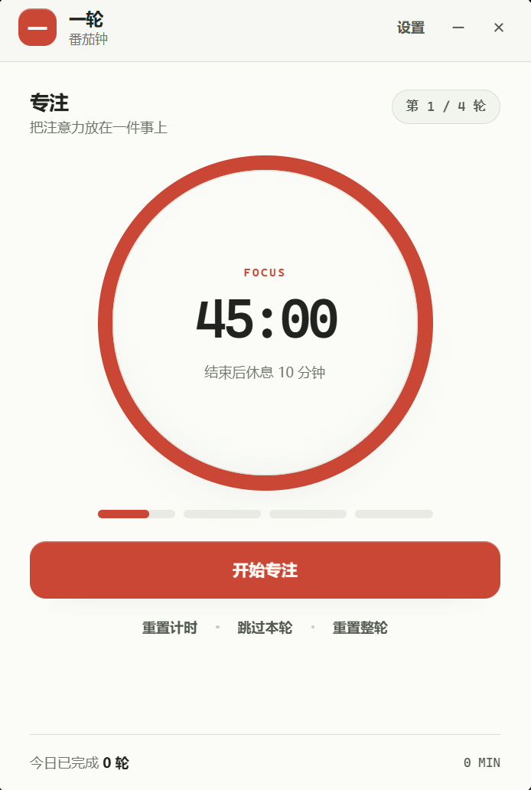
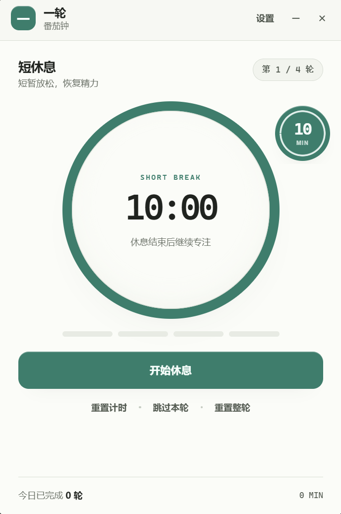
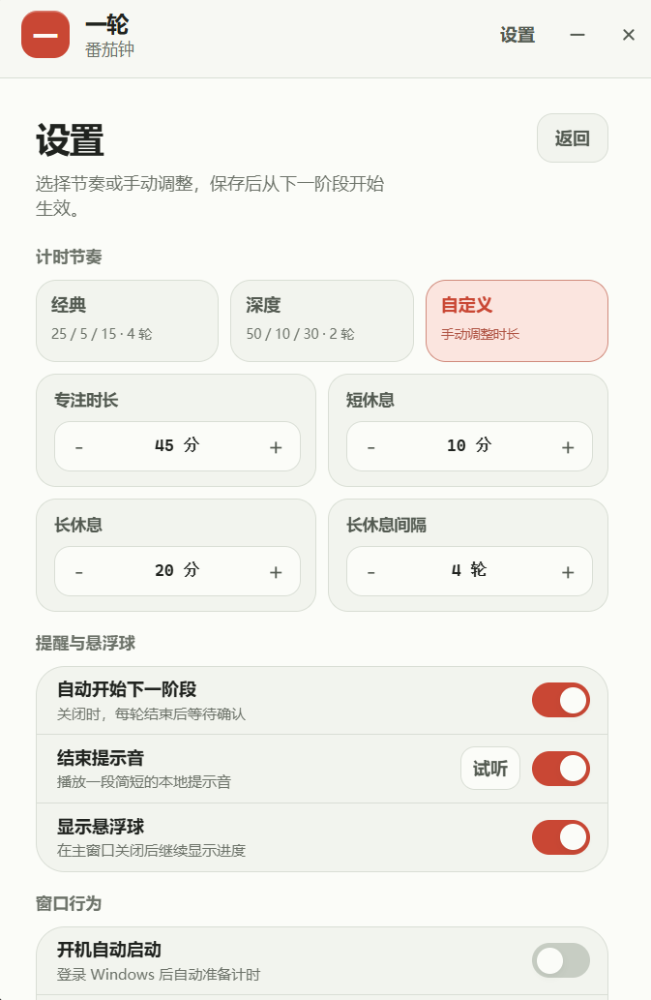

# 一轮番茄钟

一轮番茄钟是一款完全离线运行的 Windows 桌面番茄钟。你可以自定义专注和休息时长，用悬浮球查看计时进度，并在需要时重置整轮，回到第 1 轮。

## 下载安装

前往 [GitHub Releases](../../releases/latest) 下载最新的 Windows 安装程序：

- 安装版：`PomodoroApp_0.1.0_x64-setup.exe`
- 便携版：`pomodoro-app.exe`

GitHub 自动生成的 **Source code (zip)** 仅供开发者查看源码，普通用户不需要下载。

## 功能

- 专注、短休息、长休息完整循环
- 自定义专注时长、休息时长和长休息间隔
- 经典、深度和自定义计时预设
- 当前阶段重置、跳过当前阶段、重置整轮回到第 1 轮
- 浅色与深色主题，阶段自动切换配色
- 系统托盘、悬浮球、阶段完成通知和提示音
- 自动开始下一阶段、开机启动、始终置顶
- 今日专注轮数与专注分钟统计
- 设置和计时状态自动持久化
- 完全离线运行，不收集用户数据

## 界面展示

| 专注计时 | 短休息与悬浮球 | 计时设置 |
| :---: | :---: | :---: |
| <a href="./docs/screenshots/main-focus.png"></a> | <a href="./docs/screenshots/short-break.png"></a> | <a href="./docs/screenshots/settings.png"></a> |

## 系统要求

- Windows 10 或 Windows 11，64 位
- Microsoft Edge WebView2 Runtime

Windows 11 通常已内置 WebView2。Windows 10 如果无法启动，请先安装微软官方 WebView2 Runtime。

## 安装说明

1. 从 Releases 下载 `PomodoroApp_0.1.0_x64-setup.exe`。
2. 运行安装程序。
3. 如果 Windows SmartScreen 提示“未知发布者”，选择“更多信息”→“仍要运行”。

当前安装包尚未进行商业代码签名，因此可能出现 SmartScreen 提示。这是 Windows 对未签名程序的常规警告。

## 升级与卸载

覆盖安装前请先从托盘退出正在运行的番茄钟。

- 普通卸载：通过 Windows“设置”→“应用”卸载，用户数据和设置默认保留。
- 开发或便携部署可使用项目中的 `install.ps1` 与 `uninstall.ps1`。
- 只有显式运行 `uninstall.ps1 -RemoveData` 才会删除本地用户数据。

## 数据与隐私

主数据目录：

```text
%APPDATA%\com.future.pomodoro
```

如果该目录不可写，应用会回退到：

```text
%LOCALAPPDATA%\PomodoroAppData
```

目录中包含设置、计时状态、悬浮球位置、主题和本地诊断日志。应用不会上传这些数据。

应用内可从“设置”→“数据与诊断”→“打开数据目录”直接打开当前目录。

## 本地开发

需要准备：

- Node.js 20+
- Rust stable
- Visual Studio C++ Build Tools
- Microsoft Edge WebView2 Runtime

安装依赖并启动开发模式：

```powershell
npm ci
npm run tauri dev
```

运行完整检查：

```powershell
npm run check
```

构建 Windows 安装包：

```powershell
npm run tauri build
```

构建产物位于：

```text
src-tauri\target\release\bundle\nsis\
```

## 项目结构

```text
src/                前端界面与悬浮球
src-tauri/          Rust 后端、计时状态机和持久化
docs/screenshots/   README 正式截图
install.ps1         本地便携部署脚本
uninstall.ps1       本地便携卸载脚本
```

## 许可证

本项目使用 [MIT License](LICENSE)。
